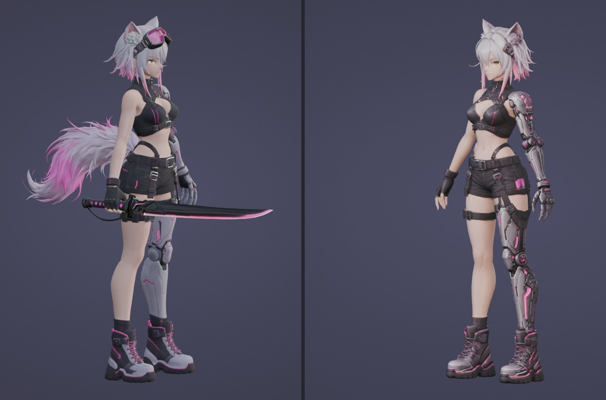
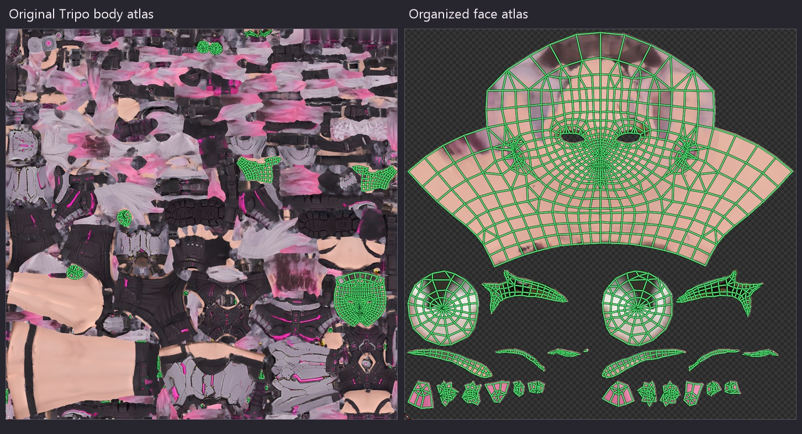
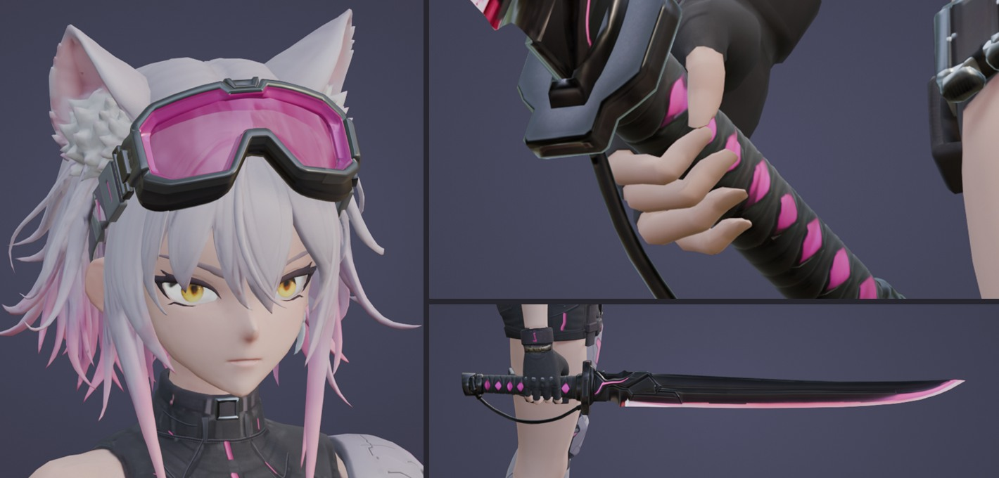

# From Tripo Smart UVs to textures I can paint

I could point to the cheek I wanted to touch up on Voomi. Finding that cheek on her generated texture sheet was harder. This guide shows how my AI assistant, Astra, and I used **Blender and Krita** to turn Tripo’s Smart UV layout into eight regional base-color maps while keeping the original model, UVs, and textures.

**[Read the nine-page illustrated guide (PDF)](./From-Tripo-Smart-UVs-to-Paintable-Textures.pdf)**

*On the left is Voomi after we cleaned up her textures and fitted the goggles and sword. On the right is an original Tripo model from before those changes.*

## The same face on two maps

On the shared body sheet, parts of the face sit among hair, clothes, and hardware. On the regional sheet, the cheeks, nose, and lips form one upright patch. The first bake still carried over the marks the hair had left on the forehead. Now I could see where to repair them in Krita.

## How we took turns

1. **Astra proposed a region and handed me the mouse.** On a working copy, Astra highlighted a first pass in Blender and left the surrounding geometry visible. Unwrapping waited until I had checked the selection.
2. **I decided what belonged.** In Edit Mode I orbited the model, using `L` to add a linked piece under the cursor, `Shift + L` to remove one, and individual faces for boundaries where skin and clothing joined. On the face pass, the proposal included the earring connector. I added the curved pendant beneath it. Those 36 faces brought the approved selection from **1,465 to 1,501**.
3. **Astra saved my exact selection and transferred the color.** A named face attribute let us recall those polygons. A separate UV map placed them on a new atlas, and a base-color bake transferred the existing appearance onto it.
4. **I checked the result before we moved on.** We compared the original and the bake from the same angles. Once the region was accepted, its atlas could go to Krita with a locked original, a transparent **Cleanup** layer, and a UV guide I could switch off before exporting the painted PNG.

## What went on its own sheet

Voomi’s eight 4K maps cover the **face**, **hair and fox ears**, **body skin**, **outfit and glove**, **raised straps and hardware**, **mechanical left arm**, **mechanical left leg**, and **both boots with the right sock**. Putting the buckles on a different sheet from the cloth made it easier to paint a clean metal edge. The fox tail kept its original texture.

*The finished accessories in Blender. The bangs show through the visor, and the pink inlays remain visible between the fingers.*

For a first pass on your own model, pick one feature you want to repaint. Pages **3–4** show how to review and save its selection, pages **5–7** cover the UV layout, bake, and Krita round trip, and page **9** has three handoff prompts you can reuse.
